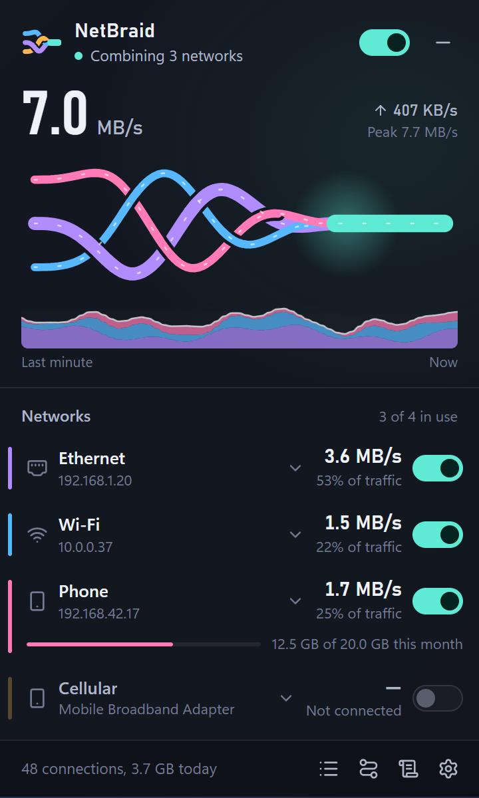
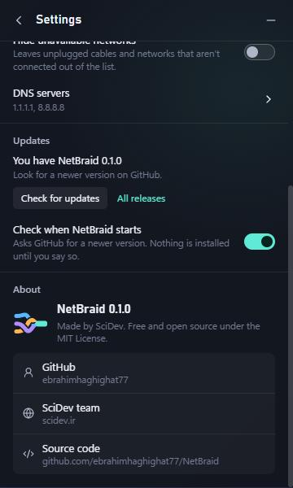

<div align="center">


# NetBraid

**Use Wi-Fi, Ethernet and a USB-tethered phone at the same time on Windows.**

NetBraid sends each new connection out on the network with the most room, so browsers, download managers,
Steam and torrents get the speed of all your networks together.

[Download the latest release](https://github.com/ebrahimhaghighat77/NetBraid/releases/latest)

</div>

## Before you install

- **The installer is not code-signed.** Windows SmartScreen will warn you; choose *More info*, then *Run anyway*.
  Check the SHA-256 on the release page if you want to be sure the file is the one built here.
- **It needs administrator rights.** While it is on, NetBraid adds a virtual network adapter (Wintun) and two routes
  that send the PC's IPv4 traffic through it, and it tells Windows to prefer IPv4. Turning it off or quitting puts
  everything back. If it ever crashes, the next start cleans up, and so does a reboot.
- **One connection always stays on one network.** A single download over one connection, a video call or a game
  session does not get faster; many connections at once do.
- **Some services dislike several addresses.** VPN plans limited to one IP and some banking sites may sign you out.
  Add a rule that keeps them on one network, or turn on *Keep each site on one network*.
- **This is the first release.** Expect rough edges, and please open an issue with the log attached if something
  goes wrong. The log lists your adapter names and local IP addresses, so look it over before you share it.

## What it does

<p align="center">
  
  &nbsp;
  
</p>

- **Your networks, braided.** Each network is a strand as thick as its share of the traffic, woven into one line
  while NetBraid is on and lying apart while it is off, with the last minute of speed underneath.
- **Health checks that fit real networks.** Each network is checked against four global endpoints and three inside
  Iran at once. A network that only reaches in-country addresses is marked *In-country only* and used last, and
  real traffic counts as proof that a network works, so a blocked probe can't take a good network out.
- **Fast recovery.** When a network is slow to answer, the next one dials alongside it and the first to connect wins.
  Connections stalled on a failing network are closed so apps reconnect elsewhere.
- **DNS through every network at once.** The first good answer wins, so one lossy network never holds a page up.
- **Rules.** Keep an app or a site on one network, or block it.
- **Backups and data caps.** Keep a phone for when the others fail, and stop using a network after a daily or monthly
  amount of data.
- **Finds every network.** PPPoE and mobile broadband connections count too. VPN and other virtual adapters are
  listed but stay off until you switch them on.
- **Updates from GitHub.** NetBraid can check for a newer release, download it, verify its SHA-256 and install it.
- **Start with Windows**, a connections list, and a log you can copy.

## Using it with a VPN

Use your VPN client in system-proxy mode: its own connections to the VPN server are spread across your networks.
Don't run a VPN's TUN mode at the same time as NetBraid; both would try to capture the same traffic.

## How it works

1. A Wintun adapter called *NetBraid* (10.222.0.1) gets the routes `0.0.0.0/1` and `128.0.0.0/1`, which beat the
   default route without replacing it.
2. A userspace TCP/IP stack turns the adapter's packets back into connections.
3. For each new connection NetBraid applies your rules, prefers working networks that reach everything over failing,
   in-country-only and backup ones, and then picks the network with the fewest busy connections for its weight and
   measured speed.
4. The outgoing socket is bound to that network's adapter, so it leaves through it and never loops back.

## Building

You need Node.js 22, Rust (stable), the Visual Studio C++ build tools and WebView2.

```sh
npm ci
npm run tauri dev     # run from an administrator terminal
npm run tauri build   # the installer lands in src-tauri/target/release/bundle/nsis
npm run dev           # just the popup, in a browser, with sample data
```

`npm test` and `cargo test` (in `src-tauri`) run the tests. Every push is built and tested by GitHub Actions, which
also publishes the installer and its checksum as an artifact.

## Made by

Ebi at [SciDev](https://scidev.ir). GitHub: [ebrahimhaghighat77](https://github.com/ebrahimhaghighat77).

NetBraid bundles [Wintun](https://www.wintun.net/) by WireGuard LLC under its prebuilt binaries license
(`src-tauri/resources/wintun-LICENSE.txt`), and is built with [Tauri](https://tauri.app/) and
[ipstack](https://crates.io/crates/ipstack).

## License

[MIT](LICENSE)
